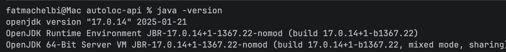

# AutoLoc API

API REST de gestion d’une plateforme de location de véhicules multi-agences, réalisée avec **Java 17**, **Spring Boot**, **Spring Data JPA**, **Hibernate** et **MySQL** dans le cadre du module Architecture des Systèmes d’Information (ESPRIT).

## Fonctionnalités

- Gestion des agences.
- Gestion des clients et des employés.
- Gestion des véhicules et des équipements.
- Gestion des réservations, contrats et paiements.
- Suivi des maintenances.
- Documentation interactive des API avec Swagger / OpenAPI.

## Technologies

- Java 17
- Spring Boot et Spring Web
- Spring Data JPA / Hibernate
- MySQL
- Maven
- Lombok
- Springdoc OpenAPI / Swagger UI

## Prérequis

- JDK 17
- MySQL (XAMPP peut être utilisé en local)
- Une base de données nommée `autoloc_db`

## Configuration

L’application utilise le profil `dev`. La configuration MySQL se trouve dans `src/main/resources/application-dev.properties`.

Le mot de passe MySQL est lu depuis la variable d’environnement `DB_PASSWORD`. Pour un serveur MySQL local sans mot de passe, la variable peut rester vide. Ne jamais ajouter de vrais mots de passe ou de fichiers `.env` au dépôt.

PowerShell :

```powershell
$env:DB_PASSWORD = "votre_mot_de_passe"
```

## Démarrer l’API

À la racine du projet :

```powershell
.\mvnw.cmd spring-boot:run
```

L’API est disponible sur `http://localhost:8080`.

## Swagger / OpenAPI

- Swagger UI : `http://localhost:8080/swagger-ui/index.html`
- Spécification OpenAPI : `http://localhost:8080/v3/api-docs`

## Compilation et tests

```powershell
.\mvnw.cmd clean test
```

Les exemples JSON pour les opérations nécessitant des relations entre entités sont disponibles dans [SWAGGER-POST-EXAMPLES.md](SWAGGER-POST-EXAMPLES.md).

## Structure principale

```text
src/main/java/tn/esprit/autoloc/
├── controller/
├── domain/
├── repository/
└── service/
```

## Capture de l’environnement


